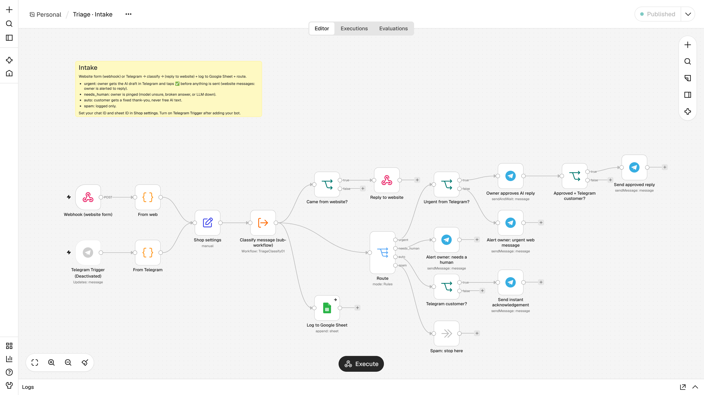

# n8n Support Triage (Amharic + English)

An n8n automation that reads customer messages for a small Ethiopian online shop, sorts them with a **free local LLM** (Ollama), and routes them, with a **human approval step** before any AI-written reply reaches a customer. It ships with its own **60-message test set and CI**, so you can measure the AI instead of hoping it works.



## What it does

| Message type | What happens |
|---|---|
| **urgent** (money lost, broken item, angry customer) | Telegram customer: owner gets the AI draft reply in Telegram and taps ✅ to send or ❌ to handle it. Website customer: owner is alerted to reply personally |
| **needs_human** (model unsure, broken answer, LLM down) | Owner is pinged in Telegram |
| **auto** (simple question) | Customer gets a fixed thank-you in their language. Never free AI text |
| **spam** | Logged only |

Every message is logged to Google Sheets. Any crash sends the owner a Telegram alert (error workflow).

## Workflows (`workflows/`)

1. **Classify message**: shared sub-workflow. Prompt + JSON schema → Ollama → guardrails (bad JSON, unknown label, server error, low confidence → `needs_human`).
2. **Intake**: website webhook or Telegram bot → classify → reply / log / route. The website only gets back the route and a fixed thank-you, never the AI's draft text.
3. **Eval**: runs the labelled test set through the same Classify step and reports accuracy, per-language accuracy, confusion matrix, and urgent messages it missed.
4. **Error alert**: Telegram alert when any triage workflow fails.

## Testing

`.github/workflows/ci.yml` runs on every push. It starts the official n8n Docker image, imports all 4 workflows, and runs them for real against a fake LLM that answers correctly **except 3 planted faults** (chatty non-JSON, invented category, HTTP 500):

```
| model | n | category acc | urgency acc | urgent missed | english | amharic | amharic_latin |
| mock  | 60 | 95% | 95% | 0 | 90% | 100% | 100% |
PASS: all 3 planted faults were caught and routed to a human
PASS: routes, urgent alert, human alert and error alert all work; no AI text reaches the website
```

`model-eval.yml` (run by hand from the Actions tab) installs Ollama and scores a real model on the same 60 messages.

**Real model results:** not run yet. Default model is `gemma3:4b`, picked because it scored best on Amharic in my [amharic-llm-bench](https://github.com/Beki-hck/amharic-llm-bench).

## Run it

1. Install [Ollama](https://ollama.com), then `ollama pull gemma3:4b`.
2. Start n8n: `npx n8n` (needs Node 24) or `docker run -it -p 5678:5678 n8nio/n8n`.
3. In n8n: **Workflows → Import from file**, import the 4 files in order (1 → 4).
4. Add your Telegram bot and Google Sheets credentials to the Telegram / Sheets nodes. Fill in **Shop settings** in Intake (your Telegram chat ID and sheet ID; sheet tab named `Inbox`) and **Settings** in Error alert (your chat ID again).
   The **Telegram Trigger** node ships turned off, so the workflow can be published before you have a bot. Turn it on once your bot credential is added.
5. Publish Classify first, then the others. Test: `curl -X POST localhost:5678/webhook/triage -H "content-type: application/json" -d "{\"text\":\"Where is my order 4471?\"}"`

Telegram approval buttons need n8n reachable from the internet (n8n Cloud, or a tunnel).

## Honest limits

- Tested live: all workflows inside real n8n 2.47.7, with a fake LLM and fake Telegram API.
- Not tested live: a real Ollama model, real Telegram bot, real Google Sheets, and clicking the approval button.
- The 20 Amharic + 10 Latin-script Amharic test messages need a native-speaker review.

Built with Claude Code as a learning project. Walkthrough of every node: [docs/walkthrough.md](docs/walkthrough.md).
